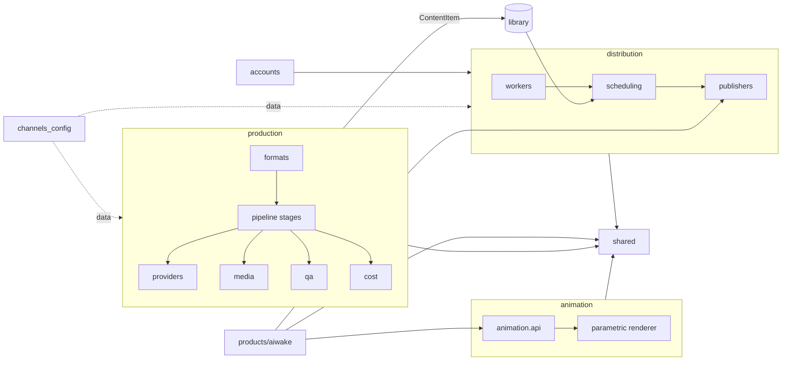

# Omni-Engine

Omni-Engine is the content factory behind a set of public pages. One command drafts a still or a short video for a channel. A worker on a small cloud VM publishes on a schedule. Generation, publishing, and the animation engine live in separate packages so each can change on its own.

The repository is public. API keys and tokens live only in `.env` (gitignored). [`.env.example`](.env.example) lists the names and stays empty of secrets. No license has been chosen yet.

Diagrams: [docs/architecture/diagrams.md](docs/architecture/diagrams.md).



## Layout

| Path | What lives there |
|---|---|
| `production/` | Pipeline, writers, providers, media, QA, cost, and formats (reels, pins, lofi, quotes) |
| `distribution/` | Publishers, the Pinterest drip and ledger, and the worker process |
| `accounts/` | Brandings, tokens, and the Pinterest account map |
| `animation/parametric/` | Product-agnostic puppet renderer. Public entry is `animation/api.py` |
| `products/aiwake/` | The Aiwake show: pipeline, personas, tools, tests |
| `channels_config/` | Per-channel data: `master_dna.json`, prompts, store. Aiwake's store stays here |
| `shared/` | Env, paths, logging, ffmpeg, storage, the `ContentItem` contract |
| `deploy/` | Dockerfile, compose, VM scripts, RunPod workflows |
| `tools/` | Operator CLIs. One-offs are `tools/oneoff/`. Lofi experiments are `tools/lofi/` |

`main.py` is the factory CLI. `config.py` loads settings. `config/` is YAML only. Tests live in `tests/` and `channels_config/<channel>/tests/`. The root allowlist is [docs/architecture/REPO_LAYOUT.md](docs/architecture/REPO_LAYOUT.md).

`ContentItem` v1 in `shared.contracts` is the only record production hands to distribution. Production does not import distribution. Distribution does not import production. `animation` does not import `products` or `production`.

Paths that moved (`engine/`, `agents/`, `core/`, `modules/`, `scripts/`, `quality/VisualQA_Agent/`, `utils/`) still import until M14. Those names are deprecated.

## Layers

**Production** turns a topic into a still or an MP4 and writes a library row. Stages live in `production/pipeline/stages/`. Formats (economic reel, lofi, pins, quotes, wealth, reference footage, Master Mei) live in `production/formats/`.

**Distribution** publishes that row. `python -m distribution.workers --role engine` stays idle so an operator can `docker compose exec` a factory run. `--role scheduler` runs the Pinterest drip. Publishers are `distribution/publishers/api/` (YouTube, Pinterest), `distribution/publishers/browser/facebook_scheduler/` (Playwright), and `distribution/publishers/export/post_planner.py` (the xlsx the WordPress bot reads).

**Animation** is the parametric puppet engine. A show calls `animation.api`. It does not reach into the renderer.

**products/aiwake** is one show on that engine. It publishes through the publisher protocol. Its runtime store stays in `channels_config/aiwake/store/`.

**channels_config** is data. `channel_profile_rows()` and `discover_channel_ids()` read the folders. [Adding a channel](#adding-a-channel) is that folder plus account files. The engine source stays as it is.

**shared** is the small base: env getters, paths, ffmpeg, B2 and Drive, retry, and `ContentItem`.

**deploy** is how the Oracle VM gets an image. Compose services stay named `engine` and `scheduler`. The scheduler is profile `scheduler`. Supermemory is profile `memory`.

**accounts** resolves brandings and Pinterest tokens. It is a top-level package.

| Layer | May import | Must not import |
|---|---|---|
| `shared` | stdlib, third party | every other package |
| `animation` | `shared` | `production`, `distribution`, `products`, `channels_config` |
| `production` | `shared` | `distribution`, animation internals, `products`. Puppets go through `animation.api` |
| `distribution` | `shared` | `production`, `animation`, `products` |
| `products.aiwake` | `animation.api`, publisher protocols, `shared` | `production`, other products |
| `channels_config/<id>` | data; a profile module may read `shared` | other packages |

## Quick start

Keyless. Reel tests use fakes. ffmpeg itself is real.

```bash
git clone https://github.com/diogolean/Omni-Engine.git
cd Omni-Engine
python -m venv .venv && source .venv/bin/activate
pip install -r requirements-ci.txt
pytest -q tests channels_config --ignore=channels_config/aiwake
OMNI_SKIP_DOTENV=1 OUTPUT_PATH=/tmp/demo python -m distribution.workers --role scheduler --once --dry-run
```

That scheduler command builds cards and logs them. It does not call Pinterest and it does not write the ledger.

A real render needs ffmpeg on `PATH` and the keys in `.env`. Install `requirements.txt` for the full media stack (`requirements-docker.txt` is the arm64 image). `main.py --test` prints scaffolds. When `GEMINI_API_KEY` is set, startup still opens a Gemini client before that scaffold returns. A keyless `--mock` flag for `main.py` is a follow-up.

```bash
python main.py --channel wonder_feed --post-type ECONOMIC_REEL --quantity 1
```

## Channels

This table is a snapshot of the folders on this commit. `production.writers.persona.channel_profile_rows()` walks `channels_config/`, keeps every folder that has `master_dna.json`, and skips `aiwake` and `shared`. Eight folders match today. The same walk is the list at 10, 20, or 100 channels. Display name, default format, and avatar mode come from that folder's `page_config.py`. Aiwake is a product, so it is not a row. The function does not assign a publisher.

| Channel | Display name | Default format | Avatar |
|---|---|---|---|
| `ancient_knowledge` | Ancient Knowledge | `IMAGE_BACKGROUND` | OFF |
| `anna_protocol` | The Holistic Legacy — Anna's Protocol | `IMAGE_AVATAR` | ON |
| `down_dirty` | Down & Dirty — Matrix Escape & Raw Mindset | `IMAGE_AVATAR` | OFF |
| `endless_summer_paradise` | Endless Summer Paradise | `REFERENCE_BASED_REELS` | OFF |
| `master_mei` | Master Mei \| Mind Control | `IMAGE_AVATAR` | ON |
| `momma_circle` | Momma Circle | `REFERENCE_BASED_REELS` | OFF |
| `principles_of_wealth_finance_economics` | Principles of Wealth — Finance & Economics | `REFERENCE_BASED_REELS` | OFF |
| `wonder_feed` | Wonder Feed — Emotional Intelligence & Relationships | `IMAGE_AVATAR` | OFF |

`python main.py --channel` accepts whatever `discover_channel_ids()` returns when the process starts (`production/pipeline/channel_context.py`). Aiwake runs from `products/aiwake/`.

## Adding a channel

Add a folder. Leave the engine source alone.

```
channels_config/<id>/
  master_dna.json     required. The walker and the CLI key off this file
  page_config.py      PAGE_DISPLAY_NAME, DEFAULT_FORMAT, DEFAULT_AVATAR_MODE, niche, fonts
  persona_dna.py      this channel's prompt sentences, beside the JSON
  tests/              pytest for this channel, collected with the factory suite
  cli.py              optional. tools/channel_cli.py loads it
  logo/logo.png       optional brand mark
```

`production.writers.persona.load_persona` reads `master_dna.json`. `persona_dna.py` is the channel's own prompt module. Momma Circle ships the JSON and `page_config.py` and has no `persona_dna.py`, and it still appears in the snapshot. A folder with `cli.py` owns `python tools/channel_cli.py --channel <id>`. A folder without one uses the Pinterest CLI. Set `IMAGE_SOURCE_POLICY` in `page_config.py` (`free_first`, `free_only`, or `ai_only`). A channel that omits it stays on `ai_only`.

Account and scheduler registration is data:

1. `config/brandings.yaml` — one branding key. Each platform (`pinterest`, `youtube`, `facebook`) has `active`. Token fields are env var names.
2. `config/pinterest_accounts.yaml` — copy a block. `active: true`. A `site_url` or board that is still `TODO` is skipped. `runner` is `local`, `docker`, `both`, or `off`. The scheduler publishes every active row. No worker edit.
3. `.env` names for that branding: `PINTEREST_ACCESS_TOKEN_<BRANDING>`, `PINTEREST_REFRESH_TOKEN_<BRANDING>`, `PINTEREST_BOARD_ID_<BRANDING>`, `PINTEREST_BOARD_NAME_<BRANDING>`, plus the app id and secret the yaml names. A per-channel file may live at `channels_config/<id>/.env.<id>` on the host (the container sees it under `channels_env/`). Values stay in `.env`.
4. YouTube, when that platform is active: `credentials/tokens/youtube_token_<id>.json`. Uploads stay on `python main.py --publish-youtube`.
5. Restart the scheduler process so it re-reads the yaml.

Facebook `active` in the branding file is recorded. Publishing still goes through Playwright (`distribution/publishers/browser/facebook_scheduler/`) or the Post Planner xlsx. There is no Facebook Graph publisher module to register.

## Scaling to N channels

The snapshot above is eight factory channels. The path to 10, 20, or 100 is the same folder and the same yaml.

**Cadence.** One scheduler process, one replica. Each wake visits every active row in `config/pinterest_accounts.yaml`, then sleeps one shared draw of `MIN_INTERVAL_HOURS` to `MAX_INTERVAL_HOURS` (default 3–6). The gap is for the process. It is not a separate clock per account. `outputs/scheduler/next_wake.json` stores that same next wake under each account id. A new row joins the next wake when the process restarts and re-reads the yaml.

**Per account, per wake.** `PINTEREST_PINS_PER_RUN` (default 1) is how many pins that account may publish on the wake. `PINTEREST_PINS_PER_DAY` (default 4) is that account's cap on the `PINTEREST_DAY_TZ` calendar day (default `America/Sao_Paulo`). One hundred active accounts, each under its cap, means one hundred pins in a single wake, then the shared sleep.

**Platform limits.** Pinterest HTTP 429 backs off and retries up to three times (`distribution/publishers/api/pinterest.py`). YouTube uploads are outside this loop. `YT_MAX_DAILY_UPLOADS` defaults to 20 per run, and `quotaExceeded` / `uploadLimitExceeded` stop the run. `YT_POST_INTERVAL_HOURS` defaults to 6. Each channel uses its own token file.

**Ledger and the VM.** Idempotency is one file, `OUTPUT_PATH/_omni/publish_ledger.json` (`OMNI_LEDGER_PATH` overrides it). Every account appends to that file. The scheduler is a single replica because the file has no conditional write. A second replica waits on that store. The wake is serial: one account, then the next, one B2 object at a time. Wake duration grows with the number of active accounts. The Oracle VM stays one arm64 engine container plus this optional scheduler. Compose does not grow a service per channel.

## Configuration

Names only. Values live in `.env`.

| Group | Keys |
|---|---|
| Runtime | `OMNI_ROLE`, `OMNI_ROOT`, `OMNI_IMAGE_TAG`, `OMNI_SKIP_DOTENV`, `OMNI_LEDGER_PATH`, `SCHEDULER_ENABLED` |
| Paths | `OUTPUT_PATH`, `ASSETS_PATH`, `OMNI_DRIVE_ROOT`, `REFERENCE_IMAGE_PATH`, `REFERENCE_AVATAR_PATH`, `FFMPEG_BINARY`, `FONT_DIRS` |
| LLM | `GEMINI_API_KEY`, `ANTHROPIC_API_KEY`, `USE_CLAUDE`, `CLAUDE_MODEL`, `CLAUDE_POLISH_MODEL`, `LOFI_SCRIPT_MODEL`, `DEEPSEEK_API_KEY`, `DEEPSEEK_BASE_URL`, `DEEPSEEK_MODEL`, `DEEPSEEK_PRO_MODEL`, `DEEPINFRA_API_KEY`, `OPENROUTER_API_KEY`, `TOGETHER_API_KEY`, `CHEAP_TEXT_CHAIN`, `CHEAP_VISION_CHAIN` |
| Media | `ELEVENLABS_API_KEY`, `IMGBB_API_KEY`, `REMOTE_GPU_BASE_URL`, `COMFYUI_BASE_URL`, `RUNPOD_API_KEY`, `RUNPOD_ENDPOINT_ID`, `RUNPOD_ENDPOINT_URL`, `CIVITAI_API_TOKEN`, `MODELS_AVATAR_BACKEND`, `MODELS_AVATAR_POD_URL`, `MODELS_AVATAR_MIN_INTERVAL_S`, `MODELS_AVATAR_MODELS_DIR` |
| Cost | `REEL_REEL_BUDGET_USD`, `REEL_BEAT_BUDGET_USD`, `REEL_NANOBANANA_MAX_PER_REEL`, `REEL_QA_MODEL_CHAIN`, `REEL_HOOK_PARALLAX`, `REEL_RENDERER`, `MAX_GOOGLE_COST_PER_RUN_USD`, `GOOGLE_COST_ALLOW_ABOVE_CEILING`, `ALLOW_GOOGLE_API`, `ELEVENLABS_BILLING`, `ELEVENLABS_LIST_WARN_USD` |
| Storage | `B2_KEY_ID`, `B2_APPLICATION_KEY`, `B2_BUCKET_NAME`, `B2_ENDPOINT_URL` |
| Pinterest | `PINTEREST_ACCESS_TOKEN`, `PINTEREST_REFRESH_TOKEN`, `PINTEREST_BOARD_ID`, `PINTEREST_BOARD_NAME`, the same four with a `_<BRANDING>` suffix, `PINTEREST_APP_ID`, `PINTEREST_APP_SECRET`, `PINTEREST_PINS_PER_RUN`, `PINTEREST_DAY_TZ`, `MIN_INTERVAL_HOURS`, `MAX_INTERVAL_HOURS` |
| Facebook | `FB_MOMMA_CIRCLE_PAGE_ID`, `FB_MOMMA_CIRCLE_ACCESS_TOKEN`, `FB_GRAPH_API_VERSION` |
| Memory | `SUPERMEMORY_BASE_URL`, `SUPERMEMORY_API_KEY`, `SUPERMEMORY_REQUIRED`, `SUPERMEMORY_AUTOSTART_WSL`, `SUPERMEMORY_DISABLED` |

## Cost defaults

The cheap stack runs first.

Text (`CHEAP_TEXT_CHAIN`): DeepInfra `deepseek-ai/DeepSeek-V4-Flash`, then OpenRouter `deepseek/deepseek-v4.1-flash`, then DeepSeek `deepseek-flash`.

Vision (`CHEAP_VISION_CHAIN`): Gemma 3 12B on OpenRouter, then the same model on DeepInfra, then `qwen/qwen3.7-flash`, then `z-ai/glm-5.3-flash`.

The reel judge (`REEL_QA_MODEL_CHAIN`) defaults to `qwen` and fails closed. Gemini joins that chain only when the variable lists it.

Claude runs only after an explicit opt-in: `USE_CLAUDE=1`, a non-empty `CLAUDE_MODEL` or `CLAUDE_POLISH_MODEL`, or `LOFI_SCRIPT_MODEL=claude`. `USE_CLAUDE=0` forces it off. A stored `ANTHROPIC_API_KEY` does not turn Claude on.

| Knob | Default |
|---|---|
| `REEL_REEL_BUDGET_USD` | `0.05` per reel. The spend ledger refuses a paid call past this |
| `REEL_BEAT_BUDGET_USD` | `0.02` |
| `REEL_NANOBANANA_MAX_PER_REEL` | `0` |
| `MAX_GOOGLE_COST_PER_RUN_USD` | ceiling `0.05`. A higher value is clamped unless `GOOGLE_COST_ALLOW_ABOVE_CEILING=1` |
| `ELEVENLABS_BILLING` | `subscription`. List price is logged and sits outside the reel cap. `metered` bills list price |
| `ELEVENLABS_LIST_WARN_USD` | `0.20` |
| `REEL_RENDERER` | `ffmpeg`. `moviepy` is the legacy renderer |
| `REEL_HOOK_PARALLAX` | off. `1` enables the depth-parallax hook. Ken Burns is the default motion |

## Docs

| | |
|---|---|
| Diagrams | [docs/architecture/diagrams.md](docs/architecture/diagrams.md) |
| Layout | [docs/architecture/REPO_LAYOUT.md](docs/architecture/REPO_LAYOUT.md) |
| Where it runs | [docs/architecture/overview.md](docs/architecture/overview.md) |
| `main.py` map | [docs/architecture/main-module-map.md](docs/architecture/main-module-map.md) |
| Commands | [docs/COMMAND_REFERENCE.md](docs/COMMAND_REFERENCE.md) |
| Setup | [docs/setup.md](docs/setup.md) |
| Deploy | [docs/deploy.md](docs/deploy.md) |
| Index | [docs/README.md](docs/README.md) |
| Target architecture | [docs/architecture/decisions/0008-target-architecture.md](docs/architecture/decisions/0008-target-architecture.md) |

Runbooks: [Google Drive](docs/runbooks/google-drive.md), [Supermemory](docs/runbooks/supermemory.md). Decision records are in [docs/architecture/decisions/](docs/architecture/decisions/).
