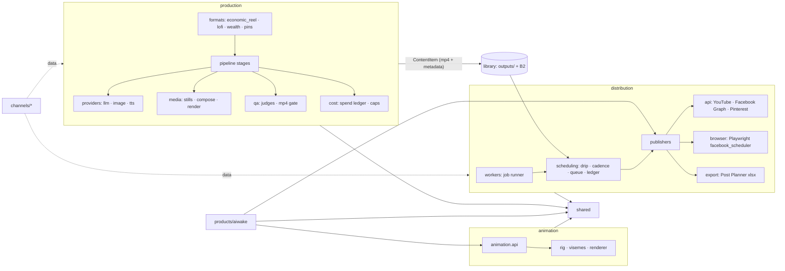
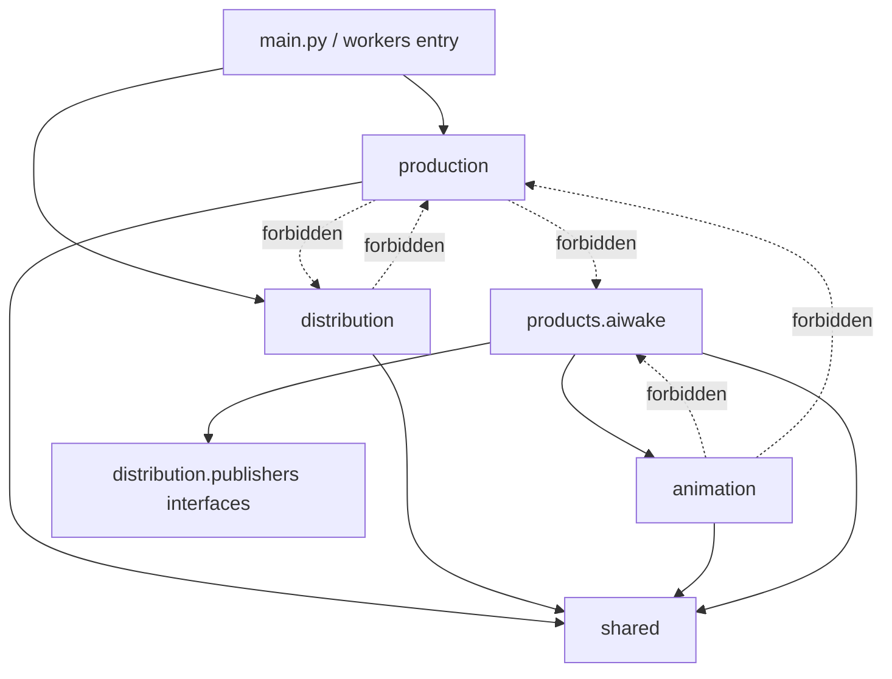
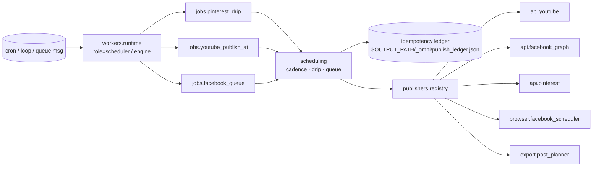

# ADR 0008: Target architecture (production, distribution, animation, deploy)

## Status

Accepted. Design only: no code moves in this PR. The draft refactor PRs #37–#46 are paused, and their destinations change to the ones below.

## Naming recorded at M3

`channels_config/` keeps its name for per-channel content config. The account registry is a separate top-level `accounts/` package, not `distribution/accounts/`. M3 does not add `accounts/`. The ContentItem canonical file stays `channels_config/<channel>/store/content_library.json`. Later steps do not rename `channels_config/` to `channels/`.

## Progress

| Step | State |
|---|---|
| M0 | Accepted. This document. |
| M1 | Import-linter contracts run in CI in report-only mode. |
| M1b | Scheduler resume from the newest real `published_utc` is in `distribution/workers/runtime.py`. |
| M2 | `shared/` has env, paths, logging, ffmpeg, mime, and retry. Old `utils.*` modules are shims. |
| M3 | `shared.store`, `shared.contracts` (`ContentItem` v1), and `shared.memory` landed. Old module paths are shims. |
| M4 | Publishers are the home of the `Publisher` protocol. This step moved the live `omni/` modules. Thin shims stay at the old import paths. |
| M5 | Partially included with M4: drip, the Pinterest scheduler, the pin ledger, the Facebook queue, inventory, and library source now live under `distribution/scheduling/`. The per-channel `$OUTPUT_PATH/_omni/locks/<canal>.lock` is not added. |
| M6 | Partially included with M4: the worker runtime lives in `distribution/workers/runtime.py`. M7 switched the compose and VM entry to `python -m distribution.workers`. The file lock from M5 is not taken yet. |
| M7 | Entrypoint switched. Compose `command:` and the Dockerfile `CMD` are `python -m distribution.workers` with the same `--role`, `--once`, `--dry-run`, `--account`, and `--pins` flags. Service names, profiles, bind mounts, and the absence of a healthcheck are unchanged. `omni/` stays as thin shims so `python -m omni.worker` still runs. Those shims come out only after a deploy on the new entrypoint is confirmed. |

M4 places the account loaders in the top-level `accounts/` package from the naming note above (`brandings`, `tokens`, `pinterest`), not under `distribution/accounts/`.

What moved, what merged, and what was deleted is listed in the M4 pull request. The pieces that stayed put, and why:

* `agents/posting/pinterest_engine/{config,articles,pin_copy,photos,flux_photo,image_transformer}.py` stay. The ADR maps them to `production/formats/pins/` (M8). Moving them into distribution would put pin production in the publisher layer.
* `agents/posting/pinterest_main.py` and `agents/posting/publish_existing.py` stay. They are live CLIs. The ADR maps them to `tools/` later. They are not dead.
* `agents/posting/youtube_publisher.py` did move, to `distribution/publishers/api/youtube_upload.py`, and still calls `agents.media.content_source` for a Drive-only file. That edge is the same call as before. It shows up in the report-only import-linter until B2/Drive clients live in `shared`.
* `distribution/scheduling/{scheduler,ledger,library_source,queue}.py` still call `agents.media` for B2, Drive, and imgbb. Same calls, new module path. The import-linter gate for “no distribution → production” is not green for those edges; M3 moved the durable store to `shared.store`, and these clients are still the media package.
* Interval and resume helpers (`interval_seconds`, `startup_delay_seconds`) stay on `distribution.workers.runtime`. Tests and the process call that module.
* Callers and tests import `distribution` and `accounts` directly. `omni/` remains a `sys.modules` shim (`omni.worker` is `distribution.workers.runtime`, and the same for the other modules) so `python -m omni.worker` is a fallback. Compose and the Dockerfile do not enter there. The shims come out after a deploy on the new entrypoint is confirmed. Logger names `omni.worker` and `omni.pinterest_drip` stay. Other shims (`utils.*`, `agents/posting/*` publisher paths) stay until M14.

## Context

The repo grew by accretion. Same-purpose code sits in `core/`, `modules/`, `agents/`, `utils/`, `omni/`, `quality/` and `channels_config/`. The audit (2026-10-19) found 13 duplicate groups, about 55 `load_dotenv` call sites, machine paths, and a package name (`omni`) that says nothing about what it does. Four concerns are tangled:

1. **Production**: write, draw, voice, render, QA and cost-cap a piece of content.
2. **Distribution**: get finished content out (APIs, browser automation, Post Planner export), on a schedule, at least once with reconciliation. A crash between publish and the ledger write is repaired by a reconcile step; nothing claims exactly-once.
3. **Animation**: the parametric puppet engine (`core/animator`). It is the base of a future SaaS product and must not depend on any channel, Aiwake included.
4. **Deploy/DevOps**: Docker, compose, the VM deploy, GPU serverless, and later Kubernetes.

Goals: few top-level folders, one home per responsibility, standard names, and boundaries a linter can enforce. Behavior is preserved and nothing is posted twice.

## Decision

### Top level (8 code/config folders, down from 16)

```
omni-engine/
├── production/      content generation: pipeline, writers, providers, media, qa, cost, formats
├── distribution/    publishers/ (api, browser, export) · scheduling/ · workers/ · accounts/
├── animation/       parametric animation engine (public API in animation/api.py)
├── products/
│   └── aiwake/      Aiwake show, built on animation/ + distribution interfaces
├── channels/        per-channel data: profile, persona, prompts, store (no engine code)
├── shared/          env & keys, paths, logging, ffmpeg, retry, storage (B2, Drive), memory client
├── deploy/          docker/, compose/, vm/, runpod/, k8s/ (future)
├── tools/           operator CLIs and one-off scripts (scripts/ merges here)
├── config/  docs/  tests/  main.py
```

### Overview



The **only** contract between production and distribution is a `ContentItem` record in the library (today the durable post JSON under `outputs/<channel>/library/` plus B2). Production never imports distribution, and distribution never imports production.

### Dependency rules (enforced with import-linter in CI)



| Layer | May import | Must not import |
|---|---|---|
| `shared` | stdlib, third party | everything else |
| `animation` | `shared` | `production`, `distribution`, `products`, `channels` |
| `production` | `shared` | `distribution`, `animation`*, `products` |
| `distribution` | `shared` | `production`, `animation`, `products` |
| `products.aiwake` | `animation.api`, `distribution.publishers` (protocols), `shared` | `production`, other products |
| `channels/<id>` | data only (YAML/JSON, prompts); a profile module may read `shared` | code imports from others |

\* If a non-Aiwake format ever needs puppets, it goes through `animation.api`, never `animation.<internals>`.

### Distribution layers



```
distribution/
├── publishers/
│   ├── base.py          Publisher protocol, Content, Account, PublishResult, TransientPublishError
│   ├── registry.py      platform name → publisher
│   ├── api/             youtube.py · facebook_graph.py · pinterest.py (+ pinterest_oauth)
│   ├── browser/         facebook_scheduler/ (Playwright, human_behavior, record_mode)
│   └── export/          post_planner.py (xlsx consumed by the Post Planner UI)
├── scheduling/
│   ├── ledger.py        idempotency (FileIdempotencyStore) + published-pins/board dedupe
│   ├── cadence.py       slots, intervals, publishAt (advance_slot, cadence_label)
│   ├── drip.py          per-account drip (from omni/pinterest_drip + pinterest_engine/scheduler)
│   └── queue.py         facebook_queue, pending items
├── accounts/            brandings.yaml, pinterest_accounts.yaml loaders, token resolution/rotation
└── workers/
    ├── runtime.py       process loop, signals, roles (from omni/worker.py)
    └── jobs/            one module per recurring job; stateless, so N replicas are possible later
```

**Horizontal scale later:** jobs stay stateless. All state lives in the ledger. Before a second replica is allowed, the ledger moves to a store with conditional writes (B2 object with ETag precondition, or Postgres `INSERT … ON CONFLICT`), and each job takes a lease. Until then, compose runs exactly one `scheduler` (ADR 0004 still applies).

### Renaming `omni/` without double posts

| omni today | target |
|---|---|
| `omni/worker.py` | `distribution/workers/runtime.py` (entry: `python -m distribution.workers`) |
| `omni/models.py`, `publisher.py`, `registry.py` | `distribution/publishers/base.py`, `registry.py` |
| `omni/adapters/pinterest.py`, `youtube.py` | `distribution/publishers/api/pinterest.py`, `youtube.py` |
| `omni/pinterest_drip.py` | `distribution/scheduling/drip.py` |
| `omni/config.py`, `accounts.py`, `pinterest_accounts.py` | `accounts/{brandings,tokens,pinterest}.py` (top-level package; see *Naming recorded at M3*) |

**Kept exactly:** `$OUTPUT_PATH/_omni/publish_ledger.json`, `OMNI_LEDGER_PATH`, `OMNI_ROLE`, `OMNI_ROOT`, `OMNI_IMAGE_TAG`, `OMNI_SKIP_DOTENV`, `_OMNI_APPLIED_PINTEREST_TOKEN/REFRESH`. `OMNI_` is the product prefix (Omni-Engine), not the package. Renaming state buys nothing and risks a fresh ledger, which would mean reposts.

Safety net:
1. A test pins `default_ledger_path()` to `…/_omni/publish_ledger.json` and checks that idempotency keys are identical before and after each move.
2. The moves use `sys.modules` shims (`omni.x is distribution.y`), so module state and monkeypatches stay single.
3. The entrypoint switch is its own PR, and it waits for Automação & Nuvem's VM check. The scheduler stays stopped during the switch (ADR 0004 `SCHEDULER_ENABLED`). After the restart, check that the ledger file path and row count are unchanged, then confirm the next pin.
4. Shims are removed only after 1–2 clean scheduler cycles.

### Parametric animation engine

```mermaid
flowchart LR
  subgraph animation [animation/ — product-agnostic]
    api[api.py<br/>Scene, Cast, Style, render(scene) -> Path] --> rig[rig/ puppet · factory]
    api --> voice[voice/ registry · visemes · rhubarb]
    api --> render[render/ compositor · ffmpeg pipe · subtitles]
    api --> assets[assets/ generator · vision]
  end
  subgraph aiwake [products/aiwake]
    show[show pipeline · personas · room · provocations] --> api
    show --> llm[own openrouter / llm_factory]
    show --> pub[distribution.publishers.api.youtube via Publisher protocol]
  end
```

- `animation/` = today's `core/animator/` + the generic parts of `channels_config/aiwake/media` (only where no Aiwake persona/brand is baked in). Public surface: `animation.api` (plus typed models). Anything else is private.
- `products/aiwake/` = the rest of `channels_config/aiwake` (pipeline, personas, prompts, tools, tests, settings, openrouter/llm_factory, its own logging and `_load_font`). Its runtime state lives in one place: `channels/aiwake/store/` (same rule as every channel, gitignored except `store/portfolio/`). Code lives only in `products/aiwake/`.
- Today's engine→Aiwake couplings to remove: `modules/metadata_auditor.py` (calls Aiwake backfill), `modules/memory/wsl.py` (imports `channels_config.aiwake.settings`), `tools/validate_aiwake_captions.py`, `scripts/build_post_planner.py`, `scripts/sync_youtube_live_metadata.py`. They move into `products/aiwake/tools/`, or they call a registered hook.
- Aiwake→engine imports allowed after the move: `shared.*` (paths, env, logging, durable store, memory client), `distribution.publishers.*` (`Publisher` protocol and registry only; concrete adapters are resolved by the registry), and the distribution contract (`ContentItem`). Imports of `modules.distribution_contract` (35) and `modules.durable_store` (22) map to `shared.contracts` (`ContentItem`) and `shared.store` (`durable_store`). Aiwake's `modules.asset_library` imports (`channels_config/aiwake/tools/{backfill_metadata,library_sanitize}.py`) must go through `shared.contracts` too, because `production/library` is off-limits to products.
- `models_avatar/` (RunPod/Civitai character images) goes to `production/providers/avatar/`. It is a generation provider, not animation.

### Production

```
production/
├── pipeline/      engine/ stages, orchestrator, runtime, cli (main.py calls it)
├── formats/       economic_reel/ (reel_artefact, grounding, hook, shot_planner), lofi/ (economic_reel_lofi),
│                  wealth/ (principles_of_wealth), pins/ (pin copy, image_transformer, flux_photo), quotes/
├── writers/       agents/writer/*, rag
├── providers/     llm/ (model_router, cheap_llm, gemini_utils, orchestrator llm) · image/ (together, deepinfra,
│                  image_provider, remote_gpu) · tts/ (audio_engine/ElevenLabs) · vision/ · avatar/
├── media/         stills, brand_composer, captions, compose, ffmpeg render (reel_ffmpeg_render, reel_sequence_engine)
├── qa/            reel_qa (gate), visual_qa, judges/ (VisualQA_Agent critic, visual_eval, judge_gate)
├── cost/          spend_ledger (owner), cost_tracker (facade), budget caps, pricing, google_guardrail
└── library/       content_library, durable_library, asset_library, content_source (writes ContentItem)
```

`channel_loader.py` → `production/pipeline/channel_context.py`. `config.py` is split: env/key bootstrap → `shared/env.py`, model and price constants → `production/providers` and `production/cost`, page paths → `shared/paths.py`.

### Shared

```
shared/
├── env.py         load .env once per entrypoint, typed getters (bool/float/path), OMNI_SKIP_DOTENV
├── paths.py       pipeline_paths (OUTPUT_PATH, OMNI_DRIVE_ROOT, find_font, repo_root)
├── logging.py     setup_cli_logging, logger names
├── ffmpeg.py      resolve, run with timeout, kill descendants (process_tools)
├── retry.py       network backoff (net_retry; never retries billing errors)
├── storage/       b2_client, b2_budget, drive_source
├── contracts.py   ContentItem (versioned) + compatibility adapters
├── store.py       durable_store (B2/Drive/local)
├── memory/        supermemory client
└── text.py, time.py, mime.py
```

### Deploy

```
deploy/
├── docker/Dockerfile         build context = repo root
├── compose/docker-compose.yml  (+ supermemory)
├── vm/remote-deploy.sh, backup_supermemory.sh
├── runpod/ (infra/runpod, infra/serverless)
└── k8s/                      (future: Deployment engine, CronJob/Deployment scheduler replicas=1, Secret refs)
```

`.github/workflows/` stays where GitHub requires it and only references `deploy/`. Moving compose changes the path that `deploy.yml` copies to the VM, so that PR needs workflow permission and Automação & Nuvem's review.

### Duplicates → one home (audit section 3)

| # | Duplicate group | Single home |
|---|---|---|
| 1 | `.env` loading, `_bool_env`/`_as_bool`/`_env_float`/`_resolve_path` | `shared/env.py` (#37 content) |
| 2 | cost: cost_tracker, spend_ledger, budget, gemini_usage prices, pricing | `production/cost/` (#39 content) |
| 3 | LLM routing: model_router, cheap_llm, orchestrator llm, direct Gemini calls, JSON extractors | `production/providers/llm/` (Aiwake keeps openrouter) |
| 4 | image providers, sanitize/compile prompt | `production/providers/image/` |
| 5 | QA judges | `production/qa/` (+ `judges/`) |
| 6 | ffmpeg resolve/run/kill | `shared/ffmpeg.py` (#38 content) |
| 7 | fonts, repo_root, outputs root | `shared/paths.py` (#35 content) |
| 8 | logging setup | `shared/logging.py` (#42 content) |
| 9 | retry/backoff | `shared/retry.py` |
| 10 | B2/Drive upload & ledgers | `shared/storage/` (scripts become thin CLIs in `tools/`) |
| 11 | persona_dna per channel | `channels/<id>/persona.yaml` + one loader in `production/writers/persona.py` |
| 12 | TTS | `production/providers/tts/` |
| 13 | time/text/mime helpers | `shared/time.py`, `shared/text.py`, `shared/mime.py` (#41 content) |
| — | Pinterest/Facebook/YouTube publishers and schedulers | `distribution/` (see above) |

### Mapping: every current top-level folder and root module

| Today | Target |
|---|---|
| `main.py` | stays (operator CLI → `production.pipeline`) |
| `config.py` | split: `shared/env.py`, `shared/paths.py`, `production/providers/*`, `production/cost/` |
| `channel_loader.py` | `production/pipeline/channel_context.py` |
| `engine/` | `production/pipeline/` |
| `core/` | `cost_tracker`, `spend_ledger`, `google_guardrail` → `production/cost/`; `cheap_llm` → `production/providers/llm/`; `remote_gpu_manager`, `comfy_workflow_convert`, `wan_*` → `production/providers/image/` (video); `reel_ffmpeg_render`, `reel_sequence_engine`, `scene_pacing`, `audio_chunker` → `production/media/`; `economic_reel_lofi` → `production/formats/lofi/`; `principles_of_wealth` → `production/formats/wealth/`; `reference_reel_engine` → `production/formats/reference/`; `animator/` → `animation/`; `interfaces`, `page_profile`, `post_type_registry` → `production/pipeline/`; `utils/fingerprint_engine` → `production/formats/wealth/` |
| `modules/` | `reel_artefact`, `reel_grounding`, `reel_hook`, `shot_planner` → `production/formats/economic_reel/`; `reel_qa`, `reel_visual_qa` → `production/qa/`; `asset_library` → `production/library/`; `distribution_contract` → `shared/contracts.py`; `durable_store` → `shared/store.py`; `memory` → `shared/memory/`; `metadata_auditor` → `tools/` (Aiwake branch → `products/aiwake/tools/`) |
| `agents/media/` | providers → `production/providers/`; stills/compose/brand → `production/media/`; `b2_*`, `drive_source`, `imgbb_client` → `shared/storage/`; `content_library`, `durable_library`, `content_source` → `production/library/`; `persona_dna`, `mei_narrative` → `production/writers/`; `free_images` → `production/providers/image/free/`; `avatar_engine` → `production/formats/mei/` |
| `agents/writer/`, `agents/rag/` | `production/writers/` |
| `agents/orchestrator/` | `production/pipeline/agentic/` |
| `agents/mcp/` | `production/providers/` (model_api_flows) |
| `agents/posting/` | `youtube_publisher`, `pinterest_engine/publisher`, `pinterest_oauth` → `distribution/publishers/api/` (done in M4; `facebook_publisher.py` was deleted, see Progress — nothing imported it except the also-deleted `scheduler_engine.py`); `facebook_scheduler/` → `distribution/publishers/browser/` (done); `post_planner` → `distribution/publishers/export/` (done); `pinterest_engine/{scheduler,ledger,facebook_queue,inventory,library_source}` → `distribution/scheduling/` (done); `pinterest_engine/{pin_copy,image_transformer,flux_photo,articles,photos}` → `production/formats/pins/` (M8, still in place); `pinterest_main`, `publish_existing` → `tools/` CLIs over distribution (still in place; live CLIs) |
| `omni/` | `distribution/` (table above) |
| `utils/` | `pipeline_paths` → `shared/paths.py`; `process_tools` → `shared/ffmpeg.py`; `run_ledger`, `gemini_usage` → `production/cost/`; `ocr_*`, `quote_renderer` → `production/formats/quotes/`; `cursor_recovery` → deleted (#36) |
| `quality/VisualQA_Agent/` | `production/qa/judges/visual_critic/`; package `critic_profiles/` → `production/qa/judges/profiles/` |
| `channels_config/<id>/` | `channels/<id>/` (data + profile); channel code (`wealth_main`, `esp_main`, `handler`, `channel_adapter`) → `production/formats/` or `tools/` |
| `channels_config/aiwake/` | `products/aiwake/` (generic animation parts → `animation/`) |
| `channels_config/shared/mei_chrome.py` | `production/formats/mei/` |
| `models_avatar/` | `production/providers/avatar/` |
| `infra/` | `deploy/runpod/` |
| `docker/`, `Dockerfile`, `docker-compose.yml` | `deploy/docker/`, `deploy/compose/` |
| `scripts/` | `tools/` (one-offs under `tools/oneoff/`, lofi experiments under `tools/lofi/`) |
| `portfolio_showcase/` | `tools/portfolio/` (or retire, see `docs/architecture/DEPRECATED.md`) |
| `assets/`, `Fonts/` | `assets/` (stays), `assets/fonts/` |
| `config/`, `docs/`, `tests/` | stay; tests mirror the new tree |

### Migration plan (small, behavior-preserving PRs)

Every PR follows the same rules: `git mv` plus a `sys.modules` shim at the old path, full suite green, keyless reel proof, Aiwake tests run separately, scheduler dry-run, gitleaks, and no merge without Diogo's OK.

| # | PR | Notes |
|---|---|---|
| M0 | This ADR | — |
| M1 | import-linter contracts in CI, in report-only mode | makes the target measurable before moving anything |
| M1b | **High priority (performance).** The scheduler resumes from the last publish in the ledger (for Pinterest, the newest `published_utc` in the B2 `PinLedger`; `next = last + cadence`) instead of the random 3–6h startup delay (`omni/worker.py` `_DEFAULT_MIN_HOURS=3.0`, `_DEFAULT_MAX_HOURS=6.0`) | Every deploy restarts the scheduler and resets that delay. Until M1b ships, merge in batches per deploy window. |
| M2 | `shared/` with env, paths, logging, ffmpeg, mime, retry; re-target the content of #35/#37/#38/#41/#42 | old `utils.*` become shims |
| M3 | `shared/store`, `shared/contracts` (**`ContentItem` v1**, see below), `shared/memory` | Exit gate: production writes `ContentItem` v1 and distribution reads it without importing production; old readers still work through adapters. M4 does not start before this passes. |
| M4 | `distribution/publishers` (base, registry, api, browser, export) — the only home of the `Publisher` protocol | Exit gate: import-linter shows no `distribution → production` import; publisher tests green. |
| M5 | `distribution/accounts` + `distribution/scheduling` (ledger, drip, cadence, queue) | Exit gate: ledger paths and old/new idempotency keys pinned by tests; all three Pinterest stores unchanged (see *Pinterest state safety*). Adds, as an extra within one host only, a per-channel file lock at `$OUTPUT_PATH/_omni/locks/<canal>.lock`, even with 1 replica: a manual CLI run or `publish_existing` running alongside the scheduler can duplicate pins. It does **not** coordinate the PC and the VM; the single-writer fence below does. |
| M6 | `distribution/workers` (runtime + jobs) | The entrypoint switch is M7. Every publishing path (scheduler, CLI, `publish_existing`) takes the `<canal>.lock` from M5 before reading or writing the ledger. Exit gate: smoke both compose roles (`--role engine` and `--role scheduler`) with `--once --dry-run`. |
| M7 | **Entrypoint switch** to `python -m distribution.workers`. Compose `command:` and the Dockerfile `CMD` use that module. `omni/` stays as a thin fallback until a deploy on the new entrypoint is confirmed. | Service names (`engine`, `scheduler`), profiles and bind mounts stay the same. (There is no compose healthcheck today.) Flags stay `--role`, `--once`, `--dry-run`, `--account`, `--pins`. Exit gate: VM procedure below, both roles smoked. |
| M8 | `production/` moves in 3 PRs: providers+cost → qa+media → pipeline+formats+writers+library | `config.py` split last |
| M9 | **Split, not rename.** `core/animator` → `animation/`; Aiwake-specific arena names, character manifests, voices, puppet factories (`factory/create_puppet.py`) and harness output paths → `products/aiwake/`; `core.google_guardrail` / `core.utils.fingerprint_engine` imports (used by `renderer.py`, `create_puppet.py`) → `shared`; ffmpeg calls (`renderer.py`, `pipeline.py`, `audio_analyzer.py`, `rhubarb.py`) → `shared/ffmpeg`. `animation.api` starts as a compatibility facade over today's `render_dynamic_animation`; internals go private only after callers move. Remove production's dependencies on Aiwake assets and the 5 engine→Aiwake couplings. | Contract: animation imports only shared. |
| M10 | `products/aiwake/` move | Aiwake tests and import smoke in their own CI job |
| M11 | `channels/` (data) and persona loader unification | per-channel byte-identical prompts test |
| M12 | `deploy/` tree + `deploy.yml` path update. Compose under `deploy/compose/` changes relative paths: `build.context: .`, the Dockerfile, `env_file: .env`, bind mounts `./outputs`, `./credentials`, `./.env`, `./channels_config→channels_env`, `./state/ancient_knowledge/store`, and `docker/supermemory`. Either set `context: ../..` and `--project-directory` explicitly, or keep the workflow copying compose to the VM root. Test both the local invocation and `/opt/omni-engine/docker-compose.yml`. | Also updates the scp paths in `deploy.yml`, moves `.github/scripts/remote-deploy.sh` to `deploy/vm/remote-deploy.sh` (the workflow calls it from there) and covers `backup_supermemory.sh`. On the VM, compose stays at `/opt/omni-engine/docker-compose.yml`. Needs a cloud agent with `workflow` scope, plus a VM check. |
| M13 | `scripts/` → `tools/`; `portfolio_showcase` decision | — |
| M14 | Remove the remaining shims (`utils.*`, `agents/posting/*`, `modules.durable_store`, and the other M2/M3 aliases) only when every consumer has migrated, checked by `rg`, **and** after 1–2 clean scheduler cycles. The `omni/` fallback comes out in its own PR after the M7 deploy is confirmed. Import-linter becomes blocking. | — |
| M15 | README rewrite (outline below) | — |

Governance: every step that changes a home updates `AGENTS.md` and `docs/architecture/REPO_LAYOUT.md` (and the root-layout test allowlist) in the same PR, not at M15.

#### `ContentItem` v1 (defined in M3, before M4)

Today there are four shapes: the dict rows written by `engine/pipeline/stage_publish.py`; `DistributionRecord` (`modules/distribution_contract.py`, stored in `channels_config/<channel>/store/content_library.json`); `distribution.publishers.base.Content`; and Pinterest's `outputs/<channel>/{content_library.json,library/}`.

- **Schema:** one pydantic model `shared.contracts.ContentItem` with `schema_version: 1`, based on `DistributionRecord` (the richest of the four).
- **Canonical path:** `channels_config/<channel>/store/content_library.json`, mirrored through `shared.store`. (`channels_config/` keeps its name; see *Naming recorded at M3*.)
- **Ownership:** production is the only writer of new items; distribution writes only publish-status fields through `shared.contracts` helpers.
- **Compatibility:** read adapters for the other three shapes; a one-shot migration tool upgrades files in place with a backup; adapters are removed in M14.

#### Pinterest state safety (M5–M7)

The live path is `distribution.workers → distribution.scheduling.drip → PinterestScheduler`. Its state is **not** `_omni/publish_ledger.json`. It is three stores:
1. B2 `PinLedger`: `pinterest/ledger/<account>.jsonl` (`agents/posting/pinterest_engine/ledger.py`);
2. per-channel `master_inventory.json`;
3. per-channel `scheduled_history.txt`.

Accounts in `config/pinterest_accounts.yaml` use `runner: both`, so the PC and the VM can both publish.

- **Single-writer fence (required for the migration):** set `runner` to `docker` (or `off`) on every account before M5 so only one host writes; restore it only after M14.
- **Distributed lease (before any cross-host concurrency):** an account/board-scoped lease with compare-and-swap on B2 (or Postgres later), with a TTL and holder id. The local `<canal>.lock` stays only as an extra inside one host.
- **Reconciliation:** on start, compare the latest Pinterest pins against the `PinLedger` and append missing rows before publishing. Publish→ledger is at-least-once; reconcile is what prevents a repost.
- **Verification:** back up and compare all three stores, plus `_omni/publish_ledger.json`, before and after each step.

#### M7 VM procedure (run by Automação & Nuvem)

1. Confirm the single-writer fence is on. Back up `$OUTPUT_PATH/_omni/publish_ledger.json`, the B2 `pinterest/ledger/*.jsonl`, and every `master_inventory.json` / `scheduled_history.txt`; record row/line counts.
2. Set `SCHEDULER_ENABLED=0`.
3. Merge and deploy.
4. Inside the container, run `python -m distribution.workers --role scheduler --once --dry-run`.
5. Confirm the paths are unchanged and every count matches step 1; smoke `--role engine --once --dry-run` too.
6. Set `SCHEDULER_ENABLED=1` and restart.
7. Confirm the next pin appears once on Pinterest and once in the `PinLedger`; run reconcile if not.

Rollback: redeploy the previous image tag, run reconcile, and restore the backups from step 1 only for stores the reconcile cannot repair.

#36 (dead files) is independent and can merge any time. #43–#46 (omni → core/modules) are superseded by M4–M7 and should be closed.

### Risks

| Risk | Level | Mitigation |
|---|---|---|
| Double post after the worker move (new ledger path or key) | High | path and key pinned by tests; scheduler stopped across the switch; single replica; ledger row count before and after |
| Deploy break on the entrypoint or compose path change | Medium | `python -m omni.worker` stays as a fallback until the new entrypoint has been deployed; VM check by Automação & Nuvem; ADR 0004 keeps publishing off |
| Hidden dynamic imports (`importlib`, page_config by path, `python -m` in docs/cron) | Medium | shims at every old path; `rg` of docs/compose/workflows per PR; scheduler dry-run |
| Monkeypatch-by-string in tests | Low | `sys.modules` aliasing keeps one module object |
| Animation extraction reveals Aiwake-specific code in core/animator | Medium | move only after import-linter reports zero `animation → products` edges |
| Workflow files need workflow permission | Low | a cloud agent with workflow scope applies only those hunks |
| Import time of the scheduler grows (package `__init__` side effects) | Low | package `__init__`s stay empty; heavy imports lazy |
| Churn for open PRs (#33) | Low | merge #33 first; then each move PR rebases trivially |

## README outline implied by this ADR

1. **What it is** in 3 lines, plus the overview mermaid above.
2. **Layers**: production · distribution (publishers / scheduling / workers) · animation · products/aiwake · channels · shared · deploy. One paragraph each, with the dependency-rules table.
3. **Quickstart (keyless mock mode)**: `pip install -r requirements-ci.txt`; the reel pipeline tests on fakes (ffmpeg real); `OMNI_SKIP_DOTENV=1 OUTPUT_PATH=/tmp/demo python -m distribution.workers --role scheduler --once --dry-run`. A real `--mock` flag for `main.py` is a follow-up: today `main.py --test` still opens a Gemini client.
4. **Channel → module map**:

| Channel | Production format | Distribution |
|---|---|---|
| ancient_knowledge | `formats/economic_reel` | api.youtube, api.pinterest (drip), export.post_planner |
| anna_protocol | `formats/quotes`, `formats/pins` | api.pinterest, export.post_planner |
| wonder_feed | `formats/economic_reel`, `formats/lofi` | export.post_planner, browser.facebook_scheduler, api.youtube |
| master_mei | `formats/mei` (avatar) | api.youtube, export.post_planner |
| momma_circle | `formats/quotes` | api.facebook_graph |
| principles_of_wealth_finance_economics | `formats/wealth` | api.youtube |
| endless_summer_paradise | `formats/reference` | api.youtube |
| down_dirty | `formats/quotes` | export.post_planner |
| aiwake | `products/aiwake` on `animation` | api.youtube (via Publisher protocol) |

(Draft: a first pass from the channel folders and the publishers in the repo. M11 replaces it with a table generated from each channel's profile, so it cannot drift.)

5. **Environment variables** (names only; values live in `.env`):

| Group | Keys |
|---|---|
| Runtime | `OMNI_ROLE`, `OMNI_ROOT`, `OMNI_IMAGE_TAG`, `OMNI_SKIP_DOTENV`, `OMNI_LEDGER_PATH`, `SCHEDULER_ENABLED` |
| Paths | `OUTPUT_PATH`, `ASSETS_PATH`, `OMNI_DRIVE_ROOT`, `REFERENCE_IMAGE_PATH`, `REFERENCE_AVATAR_PATH`, `FFMPEG_BINARY`, `FONT_DIRS` |
| LLM | `GEMINI_API_KEY`, `ANTHROPIC_API_KEY`, `DEEPSEEK_API_KEY`, `DEEPSEEK_BASE_URL`, `DEEPSEEK_MODEL`, `DEEPSEEK_PRO_MODEL` |
| Media | `ELEVENLABS_API_KEY`, `IMGBB_API_KEY`, `REMOTE_GPU_BASE_URL`, `COMFYUI_BASE_URL`, `RUNPOD_API_KEY`, `RUNPOD_ENDPOINT_ID`, `RUNPOD_ENDPOINT_URL`, `CIVITAI_API_TOKEN`, `MODELS_AVATAR_*` |
| Cost | `REEL_REEL_BUDGET_USD`, `REEL_BEAT_BUDGET_USD`, `MAX_GOOGLE_COST_PER_RUN_USD`, `ELEVENLABS_BILLING`, `ELEVENLABS_LIST_WARN_USD` |
| Storage | `B2_KEY_ID`, `B2_APPLICATION_KEY`, `B2_BUCKET_NAME`, `B2_ENDPOINT_URL` |
| Pinterest | `PINTEREST_ACCESS_TOKEN[_<BRANDING>]`, `PINTEREST_REFRESH_TOKEN[_<BRANDING>]`, `PINTEREST_BOARD_ID[_<BRANDING>]`, `PINTEREST_BOARD_NAME[_<BRANDING>]`, `PINTEREST_APP_ID`, `PINTEREST_APP_SECRET`, `PINTEREST_PINS_PER_RUN`, `MIN_INTERVAL_HOURS`, `MAX_INTERVAL_HOURS` |
| Facebook | `FB_MOMMA_CIRCLE_PAGE_ID`, `FB_MOMMA_CIRCLE_ACCESS_TOKEN`, `FB_GRAPH_API_VERSION` |
| Memory | `SUPERMEMORY_BASE_URL`, `SUPERMEMORY_API_KEY` |

6. **Docs index** (layout, deploy, runbooks, ADRs).

## Consequences

- One obvious home per concern. New code has exactly one place to go, and the linter says so.
- Production and distribution can scale and deploy independently: render workers can later run on GPU nodes, while the scheduler stays a single replica until the ledger gains conditional writes.
- The animation engine can be extracted as its own package or repo without touching any channel.
- Cost: about 15 small PRs, each needing review and a dry-run. Shims add one indirection until M14.
