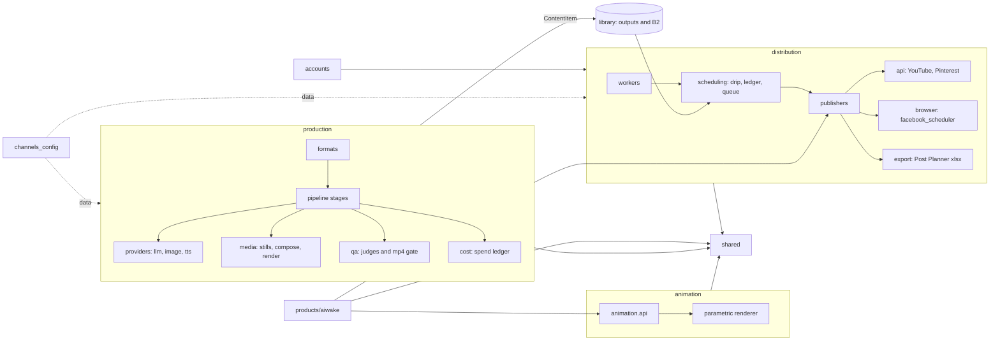
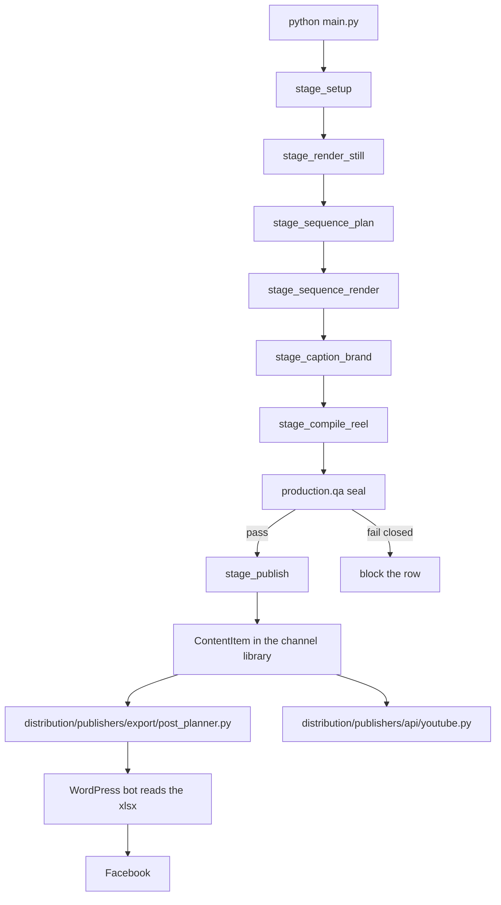
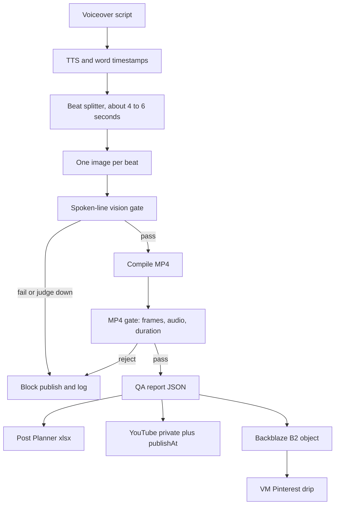
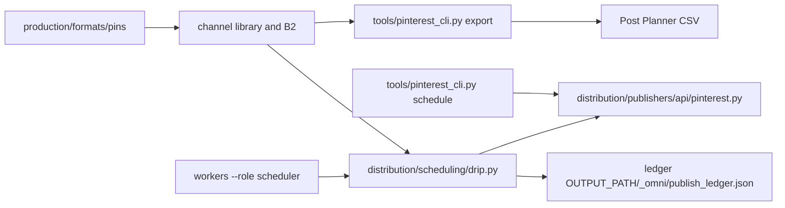
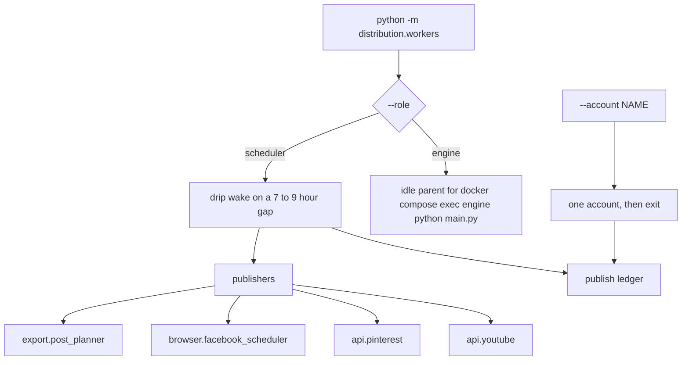
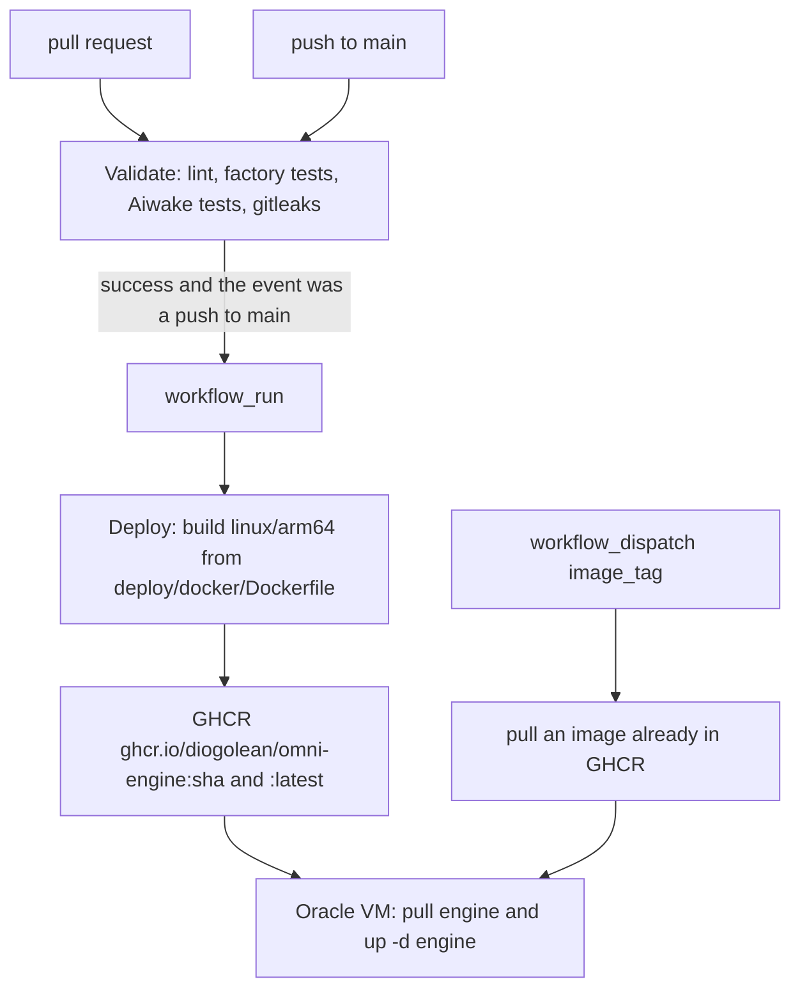
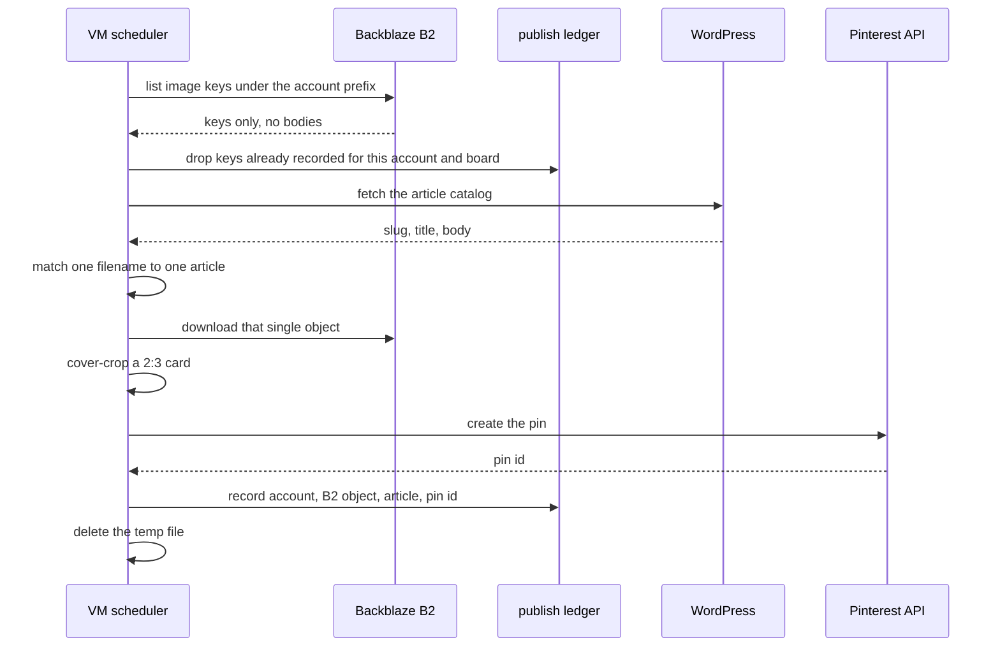

# Diagrams

Linked from the [root README](../../README.md). Boxes name the packages that exist in the tree.

## Architecture

`ContentItem` v1 (`shared.contracts`) is the record production writes and distribution reads. `accounts/` resolves tokens for the publishers. `channels_config/` is data: one folder per channel, read by `channel_profile_rows()`. The scheduler walks `config/pinterest_accounts.yaml`. Neither list is a fixed count.



Import rules are in the [README](../../README.md#layers). `animation` reaches `shared` only. A show calls `animation.api` and the publisher protocol.

## Production reel pipeline

`python main.py` enters `production/pipeline/cli.py`. The variant worker in `production/pipeline/stages/variant.py` runs the stages in this order.

`ECONOMIC_REEL_LOFI` leaves before this worker and runs `production/formats/lofi/pipeline.py`. `REFERENCE_BASED_REELS` runs `production/formats/reference/reference_reel_engine.py`. Both still seal the MP4 before a row is publishable.



Inside a reel, media moves like this. Ken Burns is the default motion. The depth-parallax hook stays off unless `REEL_HOOK_PARALLAX=1`. The renderer is ffmpeg unless `REEL_RENDERER=moviepy`.



Images prefer a free photo (Wikimedia Commons, then Openverse), then a reusable `scene_library` still, then Flux-schnell for the scene types that channel lists as safe. Flux-schnell does not draw a named artefact. Nano Banana stays off (`REEL_NANOBANANA_MAX_PER_REEL=0`).

## Pin pipeline

Pin copy, the article match, and the 2:3 card are produced in `production/formats/pins/`. Publishing is distribution.



`python tools/channel_cli.py --channel <id>` forwards to that Pinterest CLI when the channel folder has no `cli.py`.

## Distribution workers



`--once` runs a single wake and exits. `--dry-run` builds cards and logs them, and skips the Pinterest call and the ledger write. `--pins` sets the count for `--account`. A dry-run with `--account` and no `--pins` renders 5.

The Compose service names stay `engine` and `scheduler`. Deploy starts `engine` only. The scheduler is profile `scheduler` and stays stopped unless `SCHEDULER_ENABLED=1` or an operator starts the profile. One scheduler replica. The ledger is a file.

Logger names `omni.worker` and `omni.pinterest_drip` stay. The package `omni/` is gone.

## Deploy

Validate (`.github/workflows/validate.yml`) runs on every pull request and on every push to `main`. Deploy (`.github/workflows/deploy.yml`) starts from `workflow_run` after that Validate run completes. The build job runs when the Validate run succeeded, the event was a push, and the branch was `main`.



`image_tag` is required. It is a 40-character SHA or `latest`. Dispatch does not rebuild and does not deploy the SHA of whichever ref was selected in the Actions UI.

The remote step copies `deploy/compose/docker-compose.yml` to `/opt/omni-engine/docker-compose.yml` and runs:

```bash
cd /opt/omni-engine && docker compose pull engine && docker compose up -d engine
```

Local compose passes the repo root as the project directory. Commands are in [../COMMAND_REFERENCE.md](../COMMAND_REFERENCE.md) and [../deploy.md](../deploy.md).

## Pinterest publish sequence


