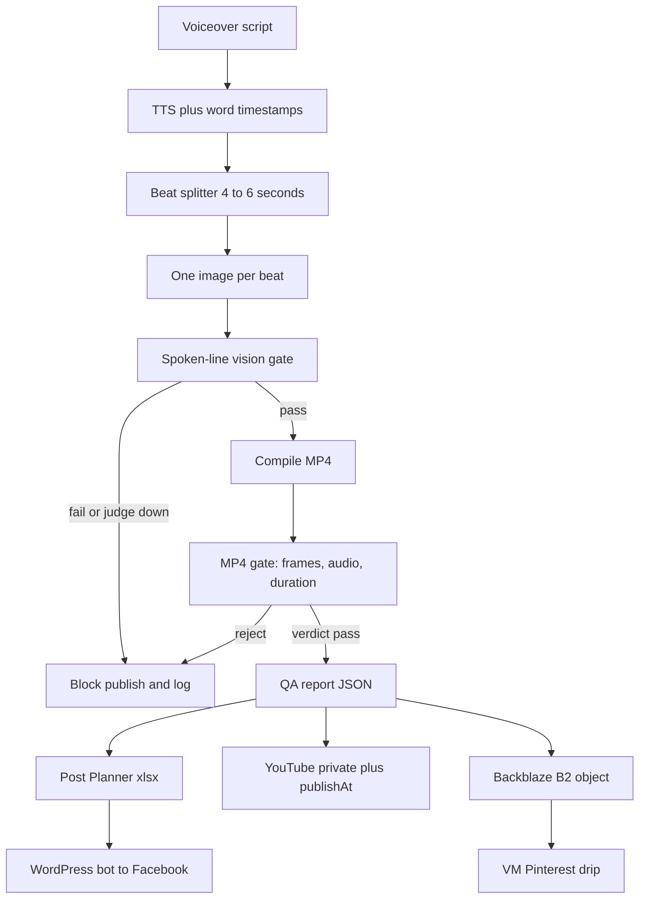
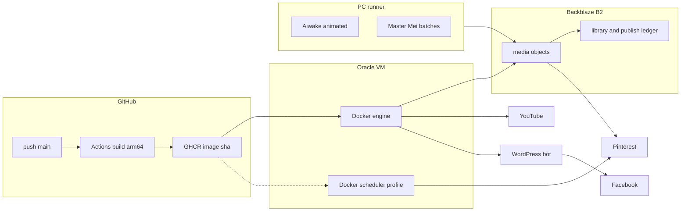
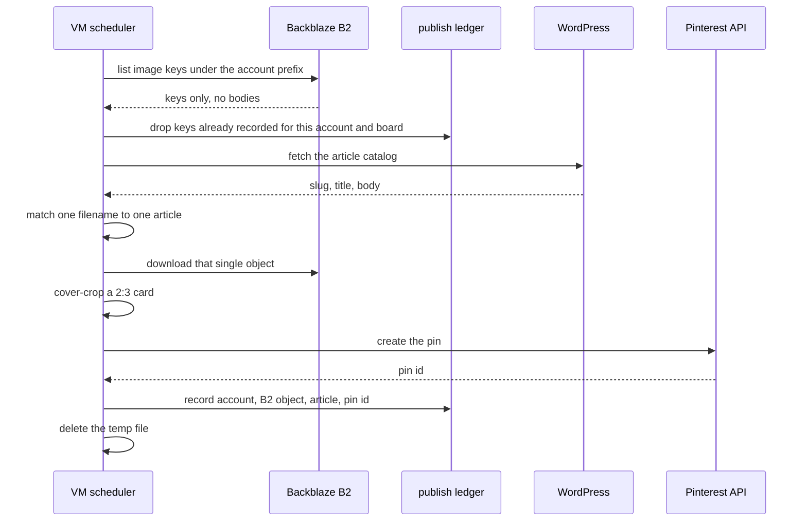

# Diagrams

## Content flow

## Deployment

Deploy starts `engine` only. The dashed line is the scheduler image, which stays stopped until `SCHEDULER_ENABLED=1` or an operator starts the Compose profile.

## Pinterest publish sequence

